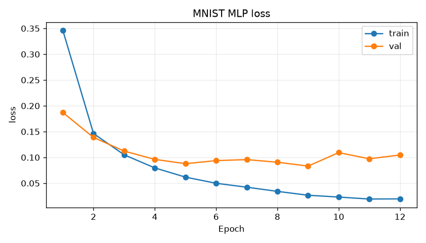
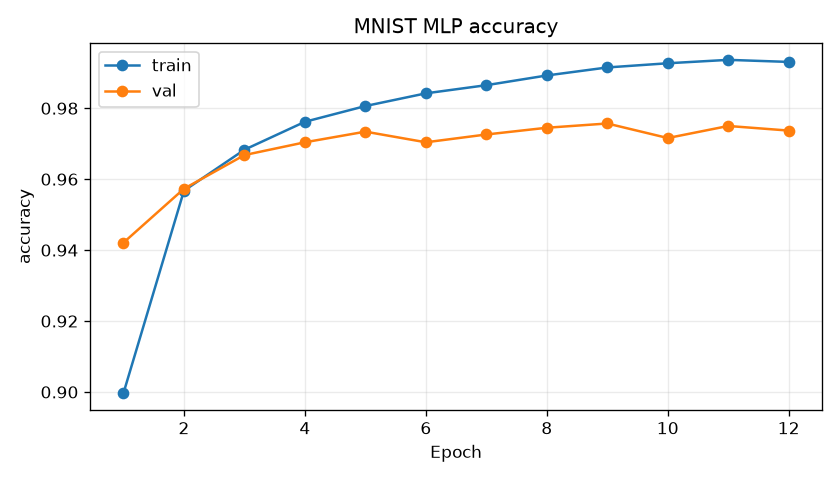
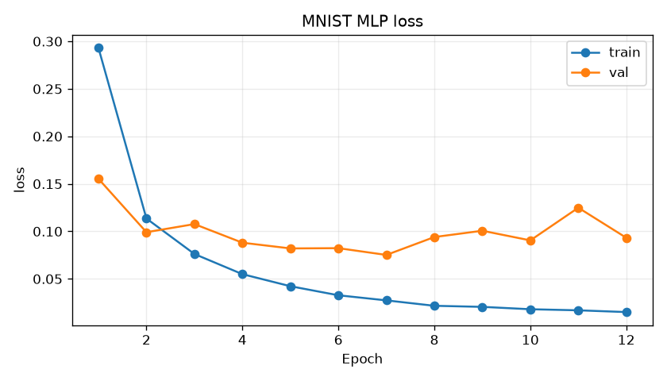
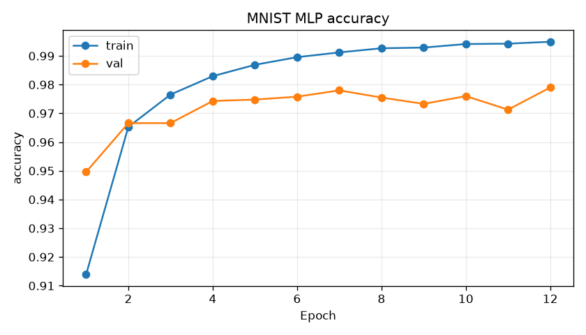
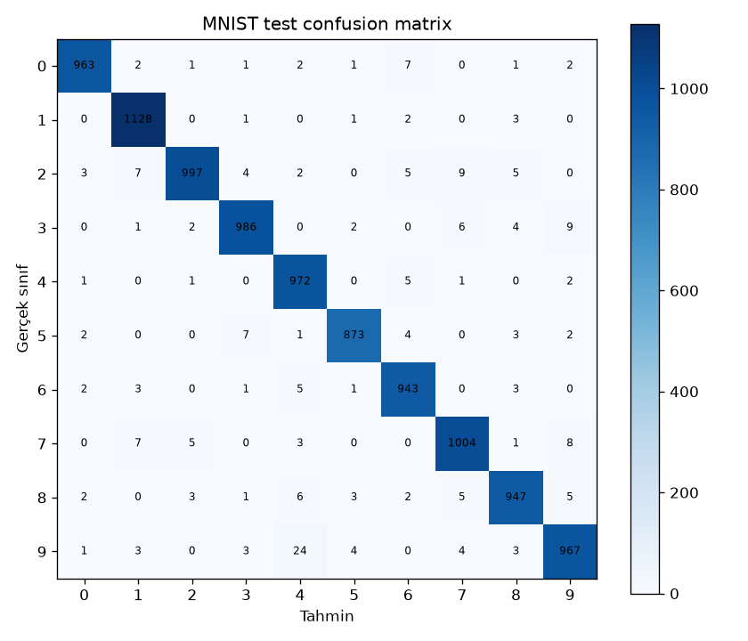

# Deney raporu: MNIST ile MLP tabanlı el yazısı rakam tanıma

## 1. Amaç ve yöntem

Bu çalışmada MNIST veri setindeki el yazısı rakamlarını MLP kullanarak sınıflandırmayı, iki farklı model yapılandırmasını karşılaştırmayı ve seçilen modeli kendi el yazıma uygulamayı amaçladım. CNN ve hazır eğitilmiş model kullanmadım.

Çalışmanın kod, deney yürütme ve rapor hazırlama aşamalarında yapay zekâ desteği aldım. Rapordaki sayısal sonuçlar gerçek çalıştırmaların JSON ve CSV kayıtlarına dayanıyor. Kişisel denemede kullandığım fotoğraf ise kendi el yazımla yazdığım öğrenci numarama ait.

## 2. Veri seti ve veri ayrımı

Çalışmada MNIST’in 60.000 örnekli eğitim havuzundan 50.000 örneği train, 10.000 örneği validation için ayırdım. Bölme işleminde seed değerini 42 olarak sabitledim. İki modelin aynı örneklerle karşılaştırılması için her iki deneyde de aynı indeksleri kullandım. Bu indeksler `results/deney-{a,b}/split.json` dosyalarında bulunuyor. Train ve validation kümelerinin kesişmediği, iki deneyin de aynı bölmeyi kullandığı programatik olarak kontrol edildi.

MNIST’in ayrı tutulan 10.000 örnekli test kümesini model seçimine dahil etmedim. Test ölçümünü yalnızca validation sonucuna göre model seçildikten sonra yaptım.

Görüntüler 28 × 28 piksel ve gri tonlamalıdır. Piksel değerlerini önce [0,1] aralığına dönüştürüp `(x−0.1307)/0.3081` işlemiyle normalize ettim. Bu normalizasyon sabitlerini deney veya test sonuçlarına göre değiştirmedim. Veri bölme işlemi rastgeledir; sınıf oranlarını koruyan stratified bir bölme uygulanmamıştır.

## 3. Model yapısı ve hiperparametreler

İki deneyde de iki gizli katmanlı bir MLP kullandım. Karşılaştırmada yalnızca gizli katmanların genişliğini değiştirdim; diğer eğitim ayarlarını aynı tuttum.

| Özellik | Deney A | Deney B |
|---|---:|---:|
| Mimari | 784 → 128 → 64 → 10 | 784 → 256 → 128 → 10 |
| Öğrenilebilir parametre | 109.386 | 235.146 |
| Gizli katman sayısı | 2 | 2 |
| Aktivasyon | ReLU | ReLU |
| Optimizer | Adam | Adam |
| Öğrenme oranı | 0.001 | 0.001 |
| Batch size | 128 | 128 |
| Epoch | 12 | 12 |
| Seed | 42 | 42 |
| Kayıp | CrossEntropyLoss | CrossEntropyLoss |

28 × 28 boyutundaki görüntü, modelin girişinde 784 elemanlı bir vektöre dönüştürülüyor. Gizli katmanlardan sonra ReLU, son katmanda ise 10 sınıf için logits üretiliyor. `CrossEntropyLoss` doğrudan logits beklediği için eğitimde çıkışa ayrıca softmax eklemedim. Ağırlıklar sıfırdan başlatıldı.

Eğitimler CPU üzerinde iki PyTorch thread kullanılarak çalıştırıldı. Kullanılan sürümler ve platform bilgisi her deneyin `environment.json` dosyasında, tam paket listesi ise `environment-lock.txt` dosyasında kayıtlıdır.

## 4. Eğitim ve validation sonuçları

Her deneyde en düşük validation loss değerine sahip checkpoint saklandı. Aşağıdaki tabloda hem bu checkpoint’in seçildiği epoch’a hem de son epoch’a ait sonuçları gösterdim.

Train ölçümleri, epoch içindeki minibatch güncellemeleri sırasında toplanmıştır. Bu nedenle bunlar, seçilen sabit checkpoint’in train kümesi üzerinde sonradan yeniden ölçülmüş sonuçları değildir. Validation ölçümleri ise her epoch sonunda sabit modelle hesaplanmıştır.

| Ölçüt | Deney A | Deney B |
|---|---:|---:|
| En iyi epoch (minimum validation loss) | 9 | 7 |
| Seçilen epoch training loss | 0.026690 | 0.027351 |
| Seçilen epoch validation loss | 0.083207 | **0.075181** |
| Seçilen epoch training accuracy | %99.150 | %99.122 |
| Seçilen epoch validation accuracy | %97.570 | **%97.800** |
| Son epoch training loss | 0.019649 | 0.015053 |
| Son epoch validation loss | 0.104741 | 0.093236 |
| Son epoch training accuracy | %99.306 | %99.492 |
| Son epoch validation accuracy | %97.370 | %97.900 |
| 12 epoch eğitim süresi | 147.998 saniye | 151.576 saniye |

Eğitim süreleri epoch döngüsünü ve checkpoint/log yazımını kapsıyor; veri indirme ve grafik üretimi bu sürelere dahil değil. Bu ölçümleri aynı sunucuda yapılan iki koşunun süresi olarak değerlendiriyorum. Tek koşudan genel bir donanım performansı veya istatistiksel hız üstünlüğü sonucu çıkarmıyorum.

### Eğitim grafikleri

Deney A’nın loss ve accuracy grafikleri:

Deney B’nin loss ve accuracy grafikleri:

### Model seçimi ve sonuçların yorumu

Final değerlendirmesi için **Deney B’nin 7. epoch checkpoint’ini seçtim**. Seçim ölçütüm en düşük validation loss idi. A modelinde bu değer 0.083207, B modelinde ise 0.075181 olarak elde edildi. Seçim kaydı test çalıştırılmadan önce `results/selection.json` dosyasına yazıldı. Bu kararı verirken test accuracy değerini kullanmadım.

Grafiklerde her iki modelin train loss değerinin düşmeye devam ettiğini, buna karşılık en iyi epoch’tan sonraki validation loss değerlerinin daha yüksek ve dalgalı kaldığını görüyorum. Bu durumu aşırı öğrenmeyle uyumlu bir işaret olarak değerlendiriyorum. Ancak tek koşuyla bunun nedenini kesinleştirmek mümkün değil. B modelinin bu deneyde daha düşük validation loss vermesi, daha büyük her modelin daha iyi sonuç vereceği anlamına da gelmiyor.

B modelinin son epoch’taki validation accuracy değeri %97.9 iken seçtiğim 7. epoch’ta bu değer %97.8’di. Buna rağmen son epoch’u seçmedim; çünkü validation loss daha yüksekti. Accuracy yalnızca doğru sınıfın seçilip seçilmediğine bakarken cross-entropy, tahmin olasılıklarını da hesaba katıyor. Bu nedenle seçimde önceden belirlenen validation loss ölçütünü korudum.

B modelinin ilk çalıştırması 8. epoch sonrasında dış kesinti nedeniyle durdu. Yarım kalan bu koşuyu karşılaştırmaya dahil etmedim. Aynı ayarlarla sıfırdan başlatılıp 12 epoch’u tamamlayan ikinci koşunun sonuçlarını kullandım; eğitim checkpoint’ten devam ettirilmedi.

## 5. Test kümesi sonucu

Validation sonucuna göre seçilen B modelinin 7. epoch checkpoint’i, ayrı tutulan 10.000 test görüntüsü üzerinde değerlendirildi.

| Ölçüt | Sonuç |
|---|---:|
| Test loss | 0.077727 |
| Test accuracy | **%97.80** |
| Doğru / toplam | **9.780 / 10.000** |
| Yanlış | 220 |

Ham ölçümler `results/final-test/test_metrics.json` dosyasında bulunuyor. Kullanılan checkpoint’in SHA-256 değeri de aynı kayıtta yer alıyor. Confusion matrix toplamının 10.000, köşegen toplamının ise 9.780 olduğu kontrol edildi; bu değerler test accuracy ile tutarlı.

Matriste satırlar gerçek sınıfı, sütunlar tahmin edilen sınıfı gösteriyor. En sık yapılan hata, gerçek 9 rakamının 4 olarak tahmin edilmesi oldu; bu hata 24 örnekte görüldü. Diğer sık hatalar 3→9 (9 örnek), 2→7 (9 örnek), 7→9 (8 örnek) ve 7→1 (7 örnek) şeklindeydi. Bu sayılar hangi sınıfların karıştığını gösteriyor, ancak görüntüler tek tek incelenmeden hatanın fiziksel nedenini açıklamıyor.

Test sonucunu gördükten sonra mimariyi, epoch seçimini veya hiperparametreleri değiştirmedim.

## 6. Kendi el yazımla yaptığım deneme

Bu bölüm için öğrenci numaramı kendi el yazımla yazıp fotoğrafını kullandım. Orijinal görüntü `handwriting/orijinal.png` dosyasında bulunuyor. Fotoğraftaki ilk iki rakamın çizgileri birbirine temas ettiği için haneler, elle belirlenen dikdörtgen sınırlarla ayrı görüntülere kırpıldı. Rakamlar yeniden çizilmedi ve modelin sonucuna göre değiştirilmedi.

Kırpma koordinatları ve görüntüden okunarak belirlenen gerçek etiketler `handwriting/kirpma-kaydi.json` dosyasında kayıtlıdır. Gerçek etiketler modelin tahminlerinden alınmadı.

Görüntülerin hazırlanmasında şu sıra uygulandı: EXIF yönünü düzeltme, gri tona dönüştürme, rakam ve arka plan renklerini MNIST’e uyarlama, rakam alanını kırpma, uzun kenarı 20 piksele ölçekleme, 28 × 28 tuvale yerleştirme, ağırlık merkezine göre merkezleme ve eğitimle aynı normalizasyonu uygulama.

Hazırlanan görüntülerin görsel kontrolünde rakamların okunabilir olduğu ve arka planın belirgin biçimde ayrıldığı görüldü. Ancak hanelerin elle kırpılması, bu çalışmanın otomatik bir numara bölütleme sistemi olmadığı anlamına geliyor.

| Hane | Gerçek | Tahmin | Sonuç |
|---|---:|---:|---|
| 1 | 2 | 2 | Doğru |
| 2 | 6 | 6 | Doğru |
| 3 | 9 | 9 | Doğru |
| 4 | 7 | 7 | Doğru |
| 5 | 9 | 9 | Doğru |
| 6 | 7 | **4** | **Yanlış** |
| 7 | 0 | 0 | Doğru |
| 8 | 1 | 1 | Doğru |
| 9 | 3 | 3 | Doğru |

Model, kendi el yazımdaki dokuz hanenin sekizini doğru tahmin etti. **Hane bazlı doğruluk 8/9, yani %88.89 oldu.** Ancak numaranın tamamı açısından baktığımda sonuç eksiksiz değil; altıncı hanede hata var. Ayrıca tek fotoğraftaki dokuz hane üzerinden modelin gerçek dünyadaki genel başarısı hakkında kesin bir oran veremem.

Altıncı hanedeki 7 rakamı, model tarafından 4 olarak tahmin edildi. Bu yanlış tahminde 4 sınıfının softmax çıktısı yaklaşık 0.9171’di. Dolayısıyla yüksek softmax çıktısını tek başına güvenilirlik göstergesi olarak almıyorum.

Yazımdaki orta çizgi, fotoğraf ve kâğıt koşulları ya da MNIST görüntüleriyle kendi görüntüm arasındaki dağılım farkı bu hatada etkili olmuş olabilir. Fakat bu deney, hangi etkenin hataya neden olduğunu ayırmaya yetmiyor. Aynı fotoğraftaki diğer 7 rakamı doğru tanındığı için yalnızca rakamın sınıfına bakarak açıklama yapmak da yeterli değil. Sonucu daha iyi göstermek için fotoğrafı seçici biçimde değiştirmedim veya test sonrasında yeniden eğitim yaptırmadım.

## 7. Sınırlılıklar ve genel değerlendirmem

Bu çalışmada iki mimariyi tek seed ve tek veri bölümüyle karşılaştırdım. Farklı seed değerleriyle tekrar deney yapmadığım için sonuçların değişkenliğini ölçmedim. Validation kümesini model ve epoch seçimi için kullandığımdan, final başarı değerlendirmesinde ayrı test kümesini esas aldım.

Kendi el yazımla yaptığım deneme de sınırlı: yalnızca dokuz hane var, bazı rakamlar tekrar ediyor ve tüm sınıflar temsil edilmiyor. Ayrıca haneler elle kırpıldığı için uçtan uca çalışan bir çok-haneli OCR sistemi geliştirmiş değilim.

Sonuç olarak sıfırdan eğitilen iki gizli katmanlı MLP ile MNIST test kümesinde %97.80 doğruluk elde ettim. Kendi el yazımda ise dokuz haneden sekizi doğru tanındı. Bu iki sonucu birlikte değerlendirdiğimde, MNIST üzerinde yüksek doğruluk elde etmenin farklı koşullarda çekilen el yazısı fotoğraflarında aynı başarıyı garanti etmediğini görüyorum. Çalışmanın en belirgin örneği, modelin yüksek softmax çıktısına rağmen altıncı hanedeki 7’yi 4 olarak tahmin etmesi oldu.
