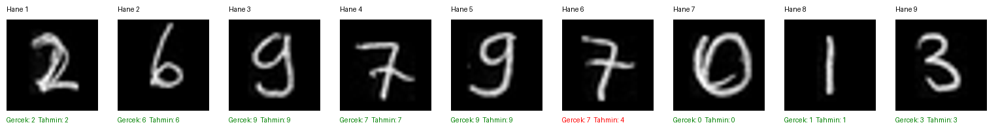

# MNIST ile MLP tabanlı el yazısı rakam tanıma

YZM517 Yapay Sinir Ağları dersi, Ödev 1

Bu çalışmada MNIST rakamlarını iki gizli katmanlı bir MLP ile sınıflandırdım. İki farklı katman genişliğini aynı veri bölümü ve eğitim ayarlarıyla karşılaştırdım. Validation loss değerine göre seçilen modeli, ayrı test kümesinde ve kendi el yazımla hazırladığım görüntülerde değerlendirdim. Kod, deney yürütme ve rapor hazırlığında yapay zekâ desteği aldım.

## Sonuçlar

| Ölçüm | Sonuç |
|---|---:|
| Seçilen mimari | 784 → 256 → 128 → 10 |
| Seçilen checkpoint | Deney B, epoch 7 |
| Validation loss | 0.075181 |
| MNIST test loss | 0.077727 |
| MNIST test doğruluğu | %97.80 (9.780/10.000) |
| Kendi el yazımda hane doğruluğu | %88.89 (8/9) |

Kendi el yazımda altıncı hanedeki 7, model tarafından 4 olarak tahmin edildi. Bu hatayı sonuçlarda korudum. Deneylerin tamamı, eğitim grafikleri ve değerlendirmem [RAPOR.md](RAPOR.md) dosyasında bulunuyor.



## Dosyalar

| Dosya veya dizin | İçerik |
|---|---|
| [RAPOR.md](RAPOR.md) | Deney düzeni, sonuçlar, grafikler ve genel değerlendirmem |
| [ANLATIM.md](ANLATIM.md) | Modelin çalışma mantığına ilişkin teknik notlarım |
| [DOGRULAMA.md](DOGRULAMA.md) | Testler ve sonuç dosyalarının tutarlılık kontrolleri |
| [KAYNAKLAR.md](KAYNAKLAR.md) | Kaynaklar ve kullanım kapsamları |
| `mlp.py` | MLP mimarisi |
| `core.py` | Veri bölme, seed, eğitim ölçümü ve checkpoint işlemleri |
| `train.py` | Train/validation eğitimi ve eğitim grafikleri |
| `evaluate.py` | Seçilen modelin ayrı test kümesinde değerlendirilmesi |
| `predict.py` | Tek rakam görüntüsünün hazırlanması ve tahmini |
| `tests/` | Mimari, veri ayrımı, ölçüm ve görüntü işleme testleri |
| `results/` | İki deneyin kayıtları, ağırlıkları ve final test sonuçları |
| `handwriting/` | Orijinal fotoğrafım, hane kırpmaları ve tahmin sonuçları |

## Kurulum

Komutlar Bash içindir. Kurulumdan sonraki örnekler repo kökünde ve sanal ortam etkinken çalıştırılır.

```bash
git clone https://github.com/mazharselvitopi/yzm517-mnist-mlp.git
cd yzm517-mnist-mlp
python -m venv .venv
source .venv/bin/activate
python -m pip install -r requirements.txt
python -m pytest -q
```

Çalışma Linux ARM64, Python 3.14.4 ve CPU üzerinde doğrulandı. Doğrudan paket sürümleri `requirements.txt`, tam ortam kaydı `environment-lock.txt` içindedir. GPU gerekli değildir. Farklı işletim sistemlerinde kurulum ayrıca doğrulanmamıştır; aynı seed kullanılsa bile farklı sürüm ve donanımda bit düzeyinde aynı sonuç garanti edilmez.

## Hazır modelle el yazısı tahmini

Repo içindeki seçilmiş modelle dokuz haneyi yeniden değerlendirmek için:

```bash
python predict.py --checkpoint results/deney-b/best.pt \
  --image handwriting/hane-01.png handwriting/hane-02.png \
          handwriting/hane-03.png handwriting/hane-04.png \
          handwriting/hane-05.png handwriting/hane-06.png \
          handwriting/hane-07.png handwriting/hane-08.png handwriting/hane-09.png \
  --output kisisel/yeniden-tahmin
```

Bu işlem eğitim yapmaz. `kisisel/yeniden-tahmin` henüz var olmayan bir dizin olmalıdır; mevcut çıktıların üzerine yazılmaz. Sonuçlar, her hane için `*_prepared.png` görüntüsü ve `predictions.json` dosyası olarak kaydedilir. Gerçek etiketlerle karşılaştırma `handwriting/metrics.json` içindedir.

`predict.py` her dosyada tek rakam bekler. Orijinal fotoğraftan hane kırpma işlemi manueldir; program tüm numarayı otomatik olarak bölmez. Ön işleme sırasında gri tona dönüştürme, renk yönünü uyarlama, rakam alanını kırpma, ölçekleme ve 28 × 28 tuvalde merkezleme uygulanır. Son adımda eğitimle aynı normalizasyon kullanılır. Softmax çıktısı, doğru tahminin garantisi olarak yorumlanmamalıdır.

## Eğitim ayarları

| Ayar | Deney A | Deney B |
|---|---|---|
| Mimari | 784 → 128 → 64 → 10 | 784 → 256 → 128 → 10 |
| Aktivasyon | ReLU | ReLU |
| Loss | CrossEntropyLoss | CrossEntropyLoss |
| Optimizer | Adam | Adam |
| Öğrenme oranı | 0.001 | 0.001 |
| Batch size | 128 | 128 |
| Epoch | 12 | 12 |
| Seed | 42 | 42 |
| Train / validation | 50.000 / 10.000 | 50.000 / 10.000 |

Modelleri sıfırdan eğittim; CNN veya hazır eğitilmiş model kullanmadım. Görüntüler 784 özellik olarak düzleştirilir ve çıkışta 10 logits üretilir. `CrossEntropyLoss` öncesinde ayrıca softmax uygulanmaz. Normalizasyon `(pixel / 255 − 0.1307) / 0.3081` şeklindedir.

Her deneyin en düşük validation loss değerine sahip checkpoint'i saklandı. İki deneyin en iyi validation loss değerleri karşılaştırıldığında B modeli seçildi. Test verisi mimari, epoch veya hiperparametre seçiminde kullanılmadı.

## Eğitimi yeniden çalıştırma

MNIST önbelleği Git deposunun dışında olmalıdır. İlk indirme internet bağlantısı gerektirir. Aşağıdaki çıktı dizinleri daha önce oluşturulmamış olmalıdır.

```bash
python train.py --data-dir "$HOME/datasets/mnist" \
  --epochs 12 --batch-size 128 --hidden-sizes 128 64 \
  --optimizer adam --lr 0.001 --seed 42 --output runs/deney-a

python train.py --data-dir "$HOME/datasets/mnist" \
  --epochs 12 --batch-size 128 --hidden-sizes 256 128 \
  --optimizer adam --lr 0.001 --seed 42 --output runs/deney-b
```

Her koşuda `config.json`, `environment.json`, `split.json`, `history.csv`, `history.json`, `summary.json`, `loss.png`, `accuracy.png` ve `best.pt` üretilir. Repo içindeki tamamlanmış deneyler `results/` altında korunur; yeni koşular bu komutlarla `runs/` altına yazılır.

Train loss ve accuracy, epoch içindeki minibatch güncellemeleri sırasında; validation ölçümleri ise epoch sonunda sabit modelle hesaplanır. Eğitim süresi epoch döngüsünü ve checkpoint/log yazımını kapsar. Veri indirme ve grafik üretimi bu süreye dahil değildir.

## Final testi yeniden çalıştırma

Tamamlanan çalışmada B modelinin 7. epoch checkpoint'i seçilmiştir. Bu checkpoint ile kayıtlı test sonucunu yeniden ölçmek için:

```bash
python evaluate.py --checkpoint results/deney-b/best.pt \
  --data-dir "$HOME/datasets/mnist" \
  --output runs/final-test-tekrar --final-model-selected
```

Bu komut, ayrı tutulan 10.000 MNIST test örneğini değerlendirir. `test_metrics.json` ile confusion matrix'in JSON, CSV ve PNG dosyalarını üretir. Matrisin satırları gerçek, sütunları tahmin edilen sınıftır.

Yeni bir A/B karşılaştırması yapılırsa önce bu yeni koşuların `best_val_loss` değerleriyle model seçilmeli, ardından ilgili checkpoint test edilmelidir. Test sonucuna bakarak ayar değiştirmek, test kümesinin tarafsız değerlendirme amacıyla kullanımını bozar.

## El yazısı görselleri

Kendi fotoğrafım ve bu fotoğraftan elde edilen görüntüler `handwriting/` altında bulunuyor. Bu görselleri ödevin parçası olarak herkese açık paylaşıyorum. Yeni kişisel denemeler için kullanılan `kisisel/` dizini Git takibinin dışındadır.
